# Mini ATM Simulator

A menu-driven ATM system built with **HTML, CSS and PHP only** (no database). The account balance is maintained only while the program is running, using a PHP session, and is cleared when the user exits.

---

## 1. Student Details

| Field | Details |
|---|---|
| Name | Payal Mehmi |
| Roll Number | 2443008 |
| Class | BCA – V |
| Project No. | 6 – Mini ATM Simulator |
| Repository | 2443008_MiniATMSimulator |

---

## 2. Project Objective

To develop a menu-driven ATM system with the options **Balance Inquiry, Deposit, Withdraw and Exit**, which maintains the balance only during program execution (no database), and shows an ATM interface displaying transaction details and the updated balance after each operation.

---

## 3. Features

- **PIN login** – access to the ATM after entering a 4-digit PIN (demo PIN: `1234`).
- **Menu-driven interface** – Balance Inquiry, Deposit, Withdraw, Mini Statement and Exit.
- **Balance Inquiry** – shows the available balance.
- **Deposit** – adds money to the balance (multiples of ₹100).
- **Withdraw** – deducts money from the balance, with quick-cash buttons (₹500, ₹1,000, ₹2,000, ₹5,000).
- **Transaction receipt** – after every deposit or withdrawal, shows date & time, transaction type, amount and updated balance.
- **Mini Statement** – lists all transactions done in the current session.
- **Validations**
  - Wrong PIN is rejected
  - Amount must be greater than zero and in multiples of ₹100
  - Withdrawal cannot exceed the available balance
  - Maximum withdrawal per transaction is ₹20,000
- **No database** – balance and history are stored in a PHP session and cleared on Exit.
- **Responsive design** – works on desktop and mobile screens.

---

## 4. Algorithm

1. Start the session. Opening balance = ₹10,000.
2. Display the PIN screen and read the PIN.
3. If PIN ≠ 1234, show "Incorrect PIN" and go to step 2.
4. Display the Main Menu:
   1. Balance Inquiry
   2. Deposit
   3. Withdraw
   4. Mini Statement
   5. Exit
5. Read the user's choice.
6. **Balance Inquiry:** display the balance. Go to step 4.
7. **Deposit:** read amount.
   - If amount ≤ 0 or not a multiple of 100, show an error and read again.
   - Else balance = balance + amount; save the transaction; show the receipt. Go to step 4.
8. **Withdraw:** read amount.
   - If amount ≤ 0 or not a multiple of 100, show an error.
   - Else if amount > 20,000, show "maximum limit" error.
   - Else if amount > balance, show "Insufficient balance".
   - Else balance = balance − amount; save the transaction; show the receipt. Go to step 4.
9. **Mini Statement:** display all transactions of the session. Go to step 4.
10. **Exit:** destroy the session (balance is cleared), show a thank-you message.
11. Stop.

## Flowchart

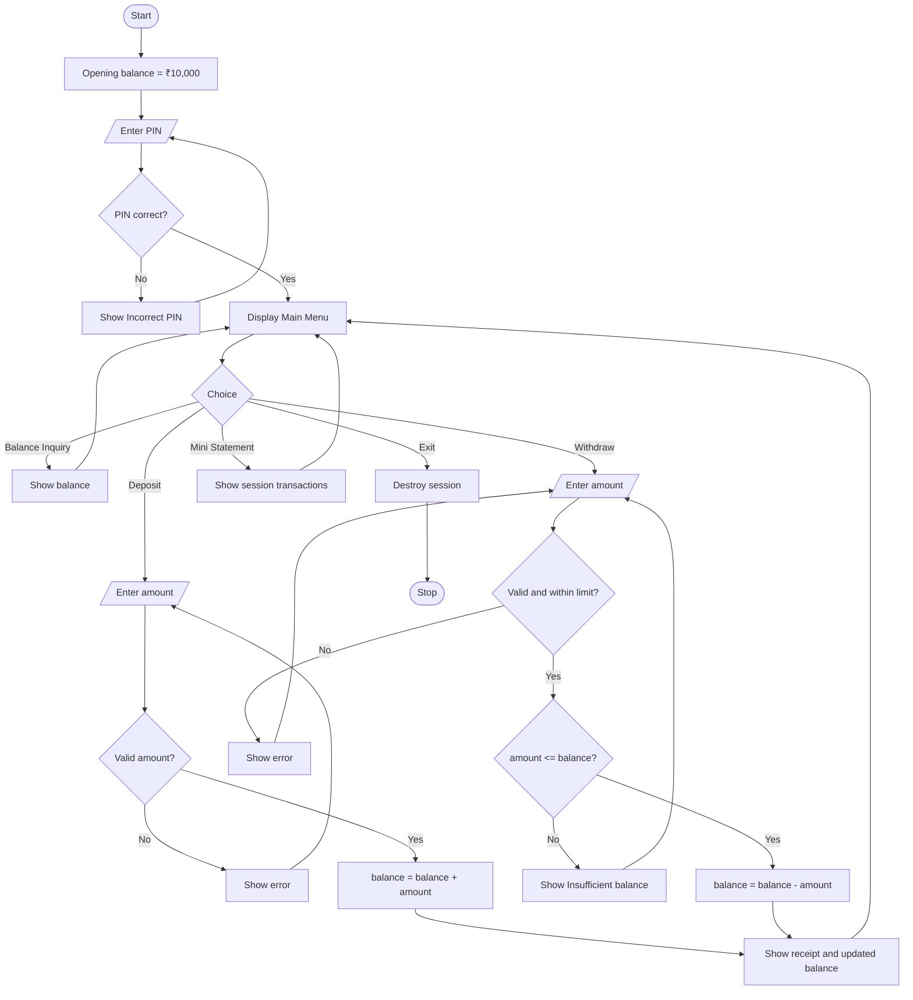

---

## 5. Technologies Used

| Technology | Purpose |
|---|---|
| HTML5 | Structure of the pages and forms |
| CSS3 | Styling and ATM-style layout |
| PHP 8 | Server-side logic, validations and session handling |
| PHP Sessions | Keeping the balance during program execution (no database) |

---

## 6. Project Structure

```
2443008_MiniATMSimulator/
├── index.php        # Main program: login, menu and all transactions
├── style.css        # Stylesheet
├── README.md        # Project documentation
└── screenshots/     # Output screenshots
```

---

## 7. Steps to Run

**Option A – PHP built-in server**

1. Install PHP (version 7.4 or above).
2. Clone the repository:
   ```bash
   git clone https://github.com/payalmehmi544/2443008_MiniATMSimulator.git
   cd 2443008_MiniATMSimulator
   ```
3. Start the server:
   ```bash
   php -S localhost:8000
   ```
4. Open `http://localhost:8000` in a browser.
5. Login with PIN **1234**.

**Option B – XAMPP / WAMP**

1. Copy the project folder into `C:\xampp\htdocs\`.
2. Start **Apache** from the XAMPP Control Panel.
3. Open `http://localhost/2443008_MiniATMSimulator/` in a browser.
4. Login with PIN **1234**.

---

## 8. Output Screenshots

### Login Screen
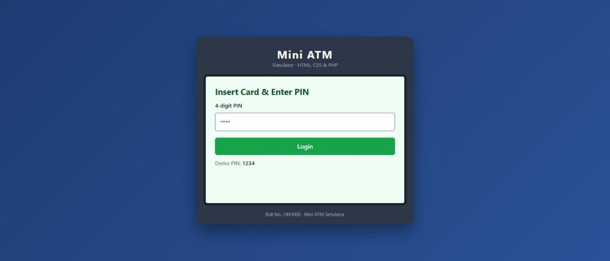

### Incorrect PIN
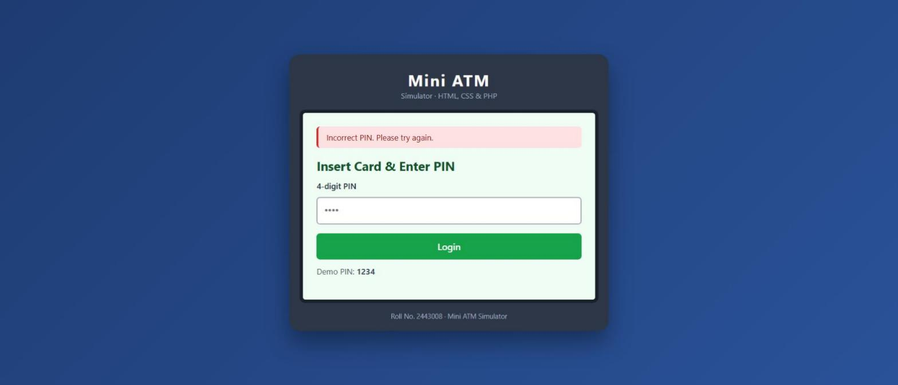

### Main Menu
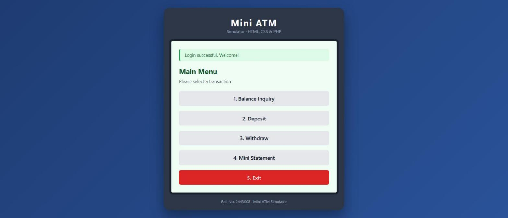

### Balance Inquiry
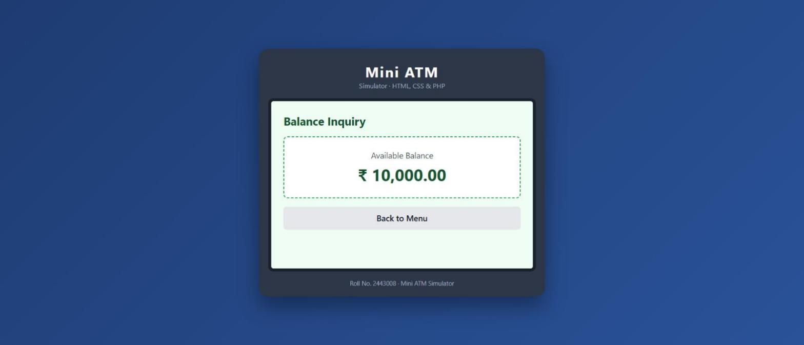

### Deposit – Transaction Receipt
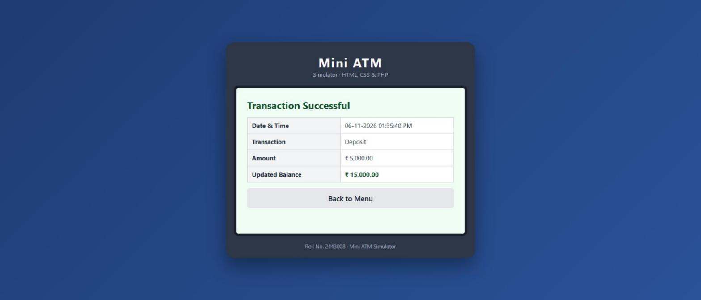

### Withdraw Screen
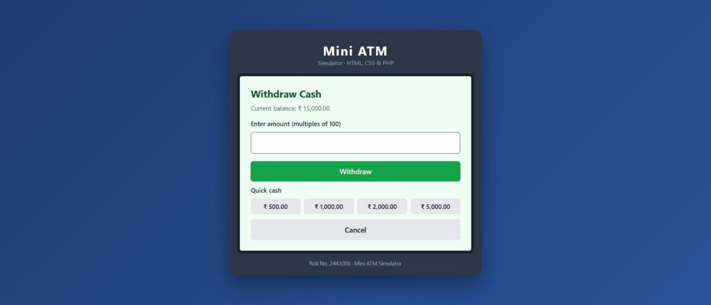

### Withdraw – Transaction Receipt
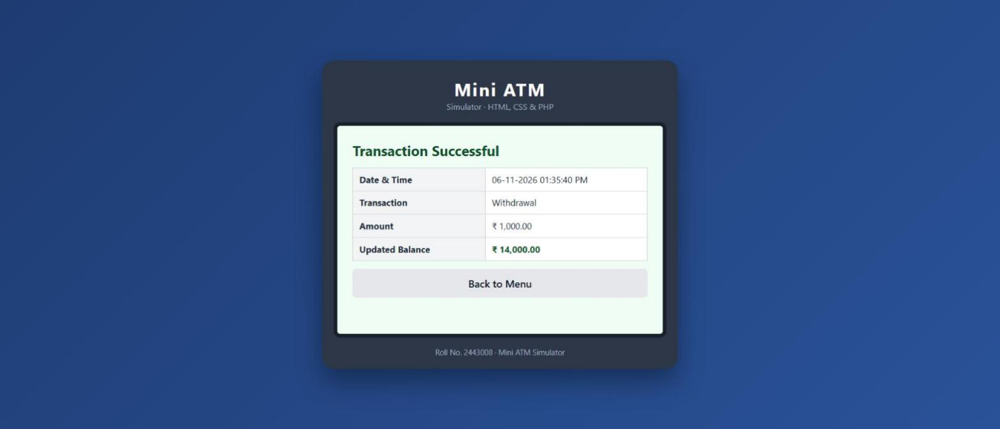

### Insufficient Balance
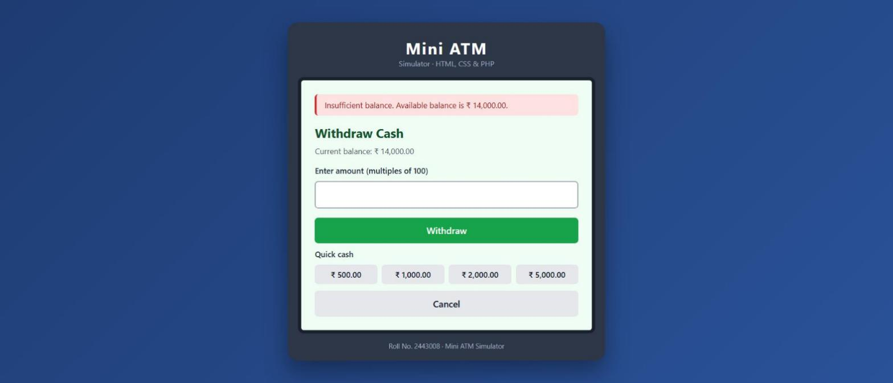

### Mini Statement
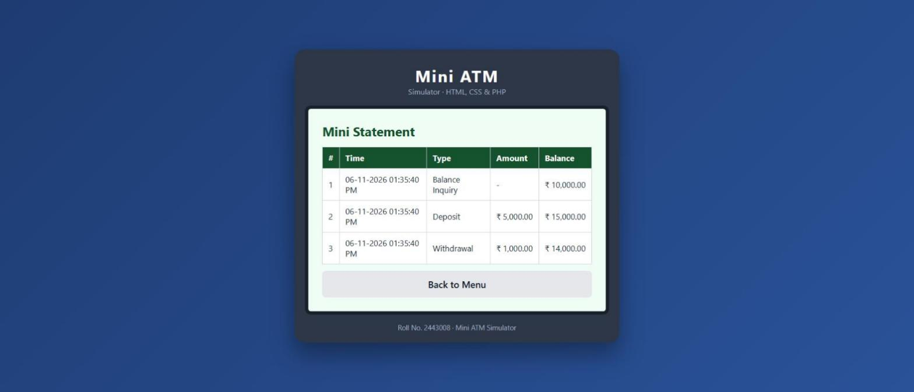

### Exit
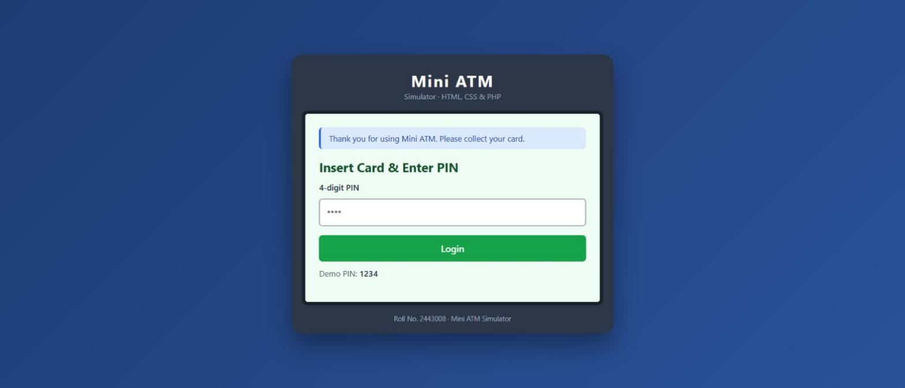
